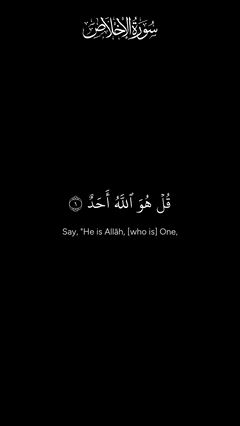
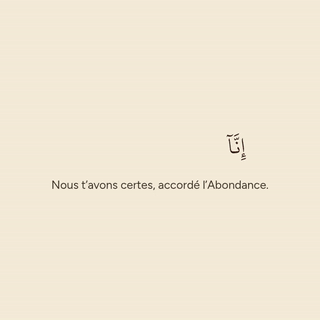
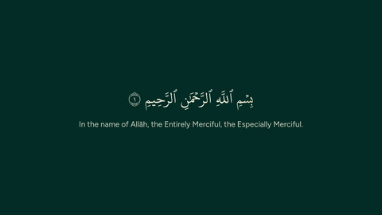
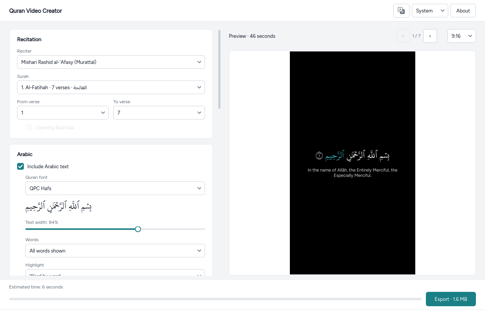

# Quran Video Creator

**Make Quran recitation videos for Reels, Shorts, TikTok and YouTube in a few clicks.** 
For any suggestions, bugs found, and other, please e-mail the following address: simplelogin-newsletter.equinox919@simplelogin.com
The Arabic lights up word by word with the reciter, with a translation under it. Free, no account, no watermark.

&nbsp;

## Get started in 3 steps

1. **Download** the file for your computer with a button above.
2. **Open it** (first time only, because the app is free and not code-signed):
   - **Windows:** unzip the file, then open `QVC.exe`. If a blue "Windows protected your PC" box
     appears, click **More info**, then **Run anyway**.
   - **macOS** (Apple Silicon: M1 or newer): open the `.dmg` and drag the app onto **Applications**. Open it once;
     when macOS refuses, go to **System Settings** > **Privacy & Security**, scroll down and click **Open Anyway**.
   - **Linux:** right-click the file > **Properties** > allow running as a program (or
     `chmod +x QVC.AppImage`), then double-click it.
3. **Make a video:** pick a reciter, a surah and the verses, then click **Export**. The video lands in your
   **Videos** folder, ready to upload.

Nothing else to install. The app needs internet to download the Quran text, translations and recitations.
All downloads: [Releases page](https://github.com/aksm26/quran-video-creator/releases/latest).

## What's new in 2.0

- **Manual mode,** a new tab for your own recitation: pick the words on a mushaf page in batches, from anywhere
  in the Quran and in any order, then set the times while the recording plays (S, E and W keys). Translations,
  a background per batch, a Preview of each screen, and projects saved as `.qvc` files. See
  [Manual mode](#manual-mode) below.
- **Long verses:** a verse too tall for the screen even at the smallest size now shows every line, over several
  screens.
- **2.0.1:** in auto mode, the ⓘ next to Export reminds you to watch the video before uploading it, since the
  timings can contain errors.
- **Also new in 1.3:** a new app icon, and the downloads are now `QVC.AppImage`, `QVC-Windows.zip` and
  `QVC-macOS.dmg`.

All changes: [CHANGELOG](CHANGELOG.md).

## What it makes

Every video below was exported by the app as is (click for the full video with sound).

| [Al-Ikhlas, 9:16](docs/examples/al-ikhlas-9x16.mp4) | [Al-Fatihah, 16:9](docs/examples/al-fatihah-16x9.mp4) | [Al-Kawthar, 1:1, French](docs/examples/al-kawthar-1x1-french.mp4) |
|---|---|---|
|  |  |  |

Recitation: Mishari Rashid al-`Afasy. Translations: English (Saheeh International), French (Muhammad Hamidullah).
Quran data provided by Quran.Foundation (https://quran.foundation).

- Formats: 9:16 (Reels, Shorts, TikTok), 16:9 (YouTube), 1:1 and 4:5 (feed posts), or all at once
- 20 reciters and 144 translations in 80 languages, or Arabic only
- Highlight word by word, or let the words appear as they are recited
- Several Quran fonts, colour themes, your own image or video as background
- Manual mode: your own recitation, words picked on a mushaf page, times set while it plays
- Cuts long verses at the stop signs, so each screen stays readable
- The interface speaks 18 languages, Arabic and Urdu right to left

## Manual mode

The **Manual mode** tab makes a video from your own recording (an audio file, or a video whose sound is used).

1. **Recording:** choose the file. Type the reciter's name if it should be in the credits.
2. **Batches:** press **Add new batch**, then click its first word and its last word on the mushaf page. A batch
   can cross verses and come from anywhere in the Quran, in any order: if the reciter goes back and repeats, add
   those words again. Each batch is a card in a scrolling list, in the order they are shown; one batch is on
   screen at a time. Clicks on the page only do something while a card is chosen: click a card to change its words
   (Esc lets it go). Its buttons give it a translation, its own picture or video, move it, or remove it.
3. **Translation** (optional): with each batch (the card's Translation button, then the first and last word of
   its translation), or on its own times (**Add translation batch**: each range is a batch of its own).
4. **Look:** font, theme (or your own, with Custom), surah name, highlight, and a background for the whole video.
   A batch's own picture or video (from its card) is shown over it while that batch is on screen.
5. **Set times:** the recording plays. Press **S** when a batch starts (that ends the one before), **E** to end
   one early and leave the screen empty, and drag any checkpoint on the bar to adjust it. With Highlight on,
   press **W** as each word is recited; words you don't tap share the time by their length. **Ctrl+Z** undoes.
   The start and end of the recording can be trimmed, and the preview shows the video as it plays.
6. **Output:** format, quality and folder, then **Export**, as in auto mode. Save the batches and times with
   **Save project** (a `.qvc` file); **Open project** loads one again. The tab also keeps your work between runs.

Above the page, **Arabic**, **Translation** and **Preview** switch the view. Preview draws the video one screen at
a time (‹ and › to step through); batches without times yet are shown for a few seconds each, so you can check
the look before setting any times. A line above the page always says what a click will do.

A saved project exports without the window too: `main.py cli manual my-video.qvc --format 9:16`.

Every batch is shown exactly as the API returns it, and the credits name the verses used. A project file keeps
only references and times, never the text: it is fetched again when the project is opened.

## Credits and rights (please read)

- Every video is saved with a `.credits.txt` file next to it, and the credits are copied to your clipboard.
  **Put them in your video's caption or description.** Quran Foundation allows sharing the videos on social media,
  monetised channels included, when Quran Foundation is credited (Developer Terms 2.2).
- Selling or redistributing the Quran data itself needs a commercial licence from Quran Foundation.
- The Quran text is shown exactly as the API returns it.
- Privacy: the app collects nothing. See the [privacy policy](PRIVACY.md) and the [terms of service](TERMS.md).
- Fonts, icons and FFmpeg keep their own licences: see [THIRD_PARTY.md](THIRD_PARTY.md).

## Run from source

You need [Python](https://www.python.org/downloads/) 3.10 or newer, [Git](https://git-scm.com/downloads) and
internet. FFmpeg comes with the Python packages, so there is nothing else to install.

    git clone https://github.com/aksm26/quran-video-creator.git
    cd quran-video-creator

Then start it:

| System | Command |
|---|---|
| Linux, macOS | `./run.sh` |
| Windows | `run.bat` (or double-click it) |

The first start creates a virtual environment in `.venv` and installs the packages from `requirements.txt`, which
takes a minute. Later starts are quick.

On Linux, if the window does not open and the error mentions the Qt "xcb" plugin, install one system library:
`sudo apt install libxcb-cursor0` (Debian, Ubuntu) or `sudo dnf install xcb-util-cursor` (Fedora).

To add a Linux menu entry, edit `Exec=` in `packaging/quran-video-creator.desktop` to point at `run.sh`, then copy
it to `~/.local/share/applications/`.

Videos are saved to the folder chosen in the app (default `~/Videos`). Downloads are cached for up to 7 days in
`~/.cache/quran-video`.

### Command line

The same exports work without the window:

    .venv/bin/python main.py cli 112 1 4 --reciter 7 --format 9:16 --out out
    .venv/bin/python main.py cli --help
    .venv/bin/python main.py cli manual my-video.qvc --format 9:16   # a project saved in the Manual mode tab

On Windows, use `.venv\Scripts\python` instead of `.venv/bin/python`. The built app has the same command line:
`QVC cli 112 1 4 ...` (on macOS: `QVC.app/Contents/MacOS/QVC cli ...`).
The Windows build exports but prints nothing, so use the source install there to see help and progress.

## How the code works

A video is made in four steps. Each step lives in its own module, and nothing under `core/` knows about the window:

    api/client.py      1. download the verses, translation, word timings and audio (cached for 7 days)
    core/timing.py     2. clean the word timings, and say which word is being recited at any moment
    core/layout.py     3. fit the words into lines, and draw the text of one frame
    core/render.py        (the Arabic, its translation and the surah name)
    core/export.py     4. plan every frame (fades, highlights), stream the frames into ffmpeg with the audio
    core/ffmpeg.py        and write the MP4 and its .credits.txt

The window (`ui/main_window.py`) and the command line (`cli.py`) both turn the user's choices into an `ExportJob`
(in `core/export.py`) and hand it to `export()`.

Manual mode reuses the same steps 3 and 4. `core/manual.py` holds the batches and the hand-set times, and turns
them into scenes: one stretch of the video with the same text on screen, pauses included.
`core/manual_export.py` makes each scene a verse and a clip for the renderer, so `frame_plan`, the encode loop and
the credits are auto mode's own. Per-batch backgrounds are laid over the base one by ffmpeg
(`ffmpeg.build_manual_cmd`). In the window, `ui/manual_tab.py` holds the tab, `ui/mushaf.py` the page to pick words
on, and `ui/timing_window.py` with `ui/timeline.py` the window where the times are set.

    main.py              starts the window, or the command line with `main.py cli ...`
    quran_video/
      api/               the Quran Foundation API client and the records it returns
      core/              everything that makes the video: timing, layout, drawing, ffmpeg
      config/            fixed choices: fonts, themes, formats, quality presets, stop signs, translation list
      ui/                the PySide6 window, its dialogs, widgets and stylesheet
      i18n.py            interface languages (the texts are in assets/locales/<language>.json)
      cli.py             the command line
    assets/              fonts, icons and interface translations
    proxy/               the Cloudflare Worker that holds the API secret (see below)
    packaging/           PyInstaller spec, AppImage script, Linux menu entry
    tools/               regenerates the translation list and the language names
    tests/               pytest

## Develop

    .venv/bin/pip install -r requirements-dev.txt
    .venv/bin/python -m pytest -q tests                     # offline tests
    QVC_API_BASE=https://qvc-proxy.quranvideocreator.workers.dev .venv/bin/python -m pytest -q tests   # all tests
    node --test proxy/worker.test.mjs                       # proxy tests (Node.js 18+)
    .venv/bin/pyinstaller packaging/quran_video.spec        # build dist/QVC for this OS
    packaging/build_appimage.sh                             # Linux: wrap it into an AppImage

The live tests (marked `slow_network`) talk to the real API through the proxy, so they only run when `QVC_API_BASE`
is set. See [CONTRIBUTING.md](CONTRIBUTING.md) for the project's rules and how to add a language, theme, font or
format.

## Run your own API proxy

Quran Foundation requires API credentials, and the client secret must not ship inside the app. So the app talks to a
tiny proxy (`proxy/worker.js`, a Cloudflare Worker) that holds the secret and forwards only the calls the app makes.
Release builds point at the maintainer's proxy. To run your own (for a fork, or to develop):

1. Register a **Backend/server** app at https://dev-console.quran.foundation/projects/new and note its client id and
   secret (pre-production credentials only see surahs 1 and 2; request production access for the rest).
2. In `proxy/` (needs Node.js and a free Cloudflare account):

       npx wrangler login
       npx wrangler secret put QF_CLIENT_ID
       npx wrangler secret put QF_CLIENT_SECRET
       npx wrangler deploy

   For pre-production credentials, switch the two URLs in `proxy/wrangler.toml` first.
3. Point the app at it: `export QVC_API_BASE=https://qvc-proxy.<your-subdomain>.workers.dev`.

Local run: put `QF_CLIENT_ID=...` and `QF_CLIENT_SECRET=...` in `proxy/.dev.vars` (git-ignored) and run
`npx wrangler dev`, then `QVC_API_BASE=http://localhost:8787`.

## Release

Bump `__version__` in `quran_video/__init__.py`, then push a version tag. GitHub Actions runs the tests, builds
Windows, macOS and Linux, and attaches them to a Release:

    git tag v1.0.0
    git push origin v1.0.0
